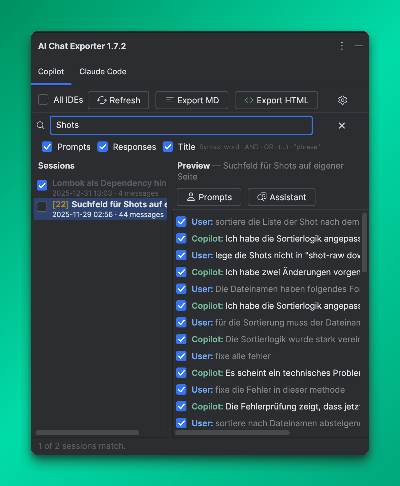
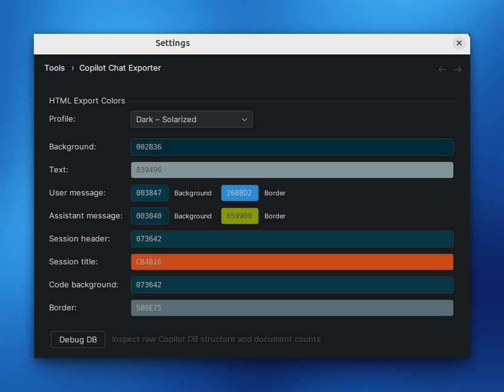

# Copilot Chat Exporter

> [Deutsche Version](README.de.md)

An IntelliJ plugin that lets you export your **GitHub Copilot** and **Claude Code** chat history to Markdown or styled HTML — directly from your IDE.

## Features

### Search
- **Search across all sessions** — find sessions by content, title, or message text in both tabs
- **Boolean query syntax** — `AND`, `OR`, exact phrases with quotes, and grouping with parentheses
- **Scope toggles** — search prompts, responses, and/or session titles independently
- **Live filtering** — sessions are filtered as you type with a match-count badge; matching messages are highlighted in the preview panel

### GitHub Copilot
- **Browse all Copilot chat sessions** — inline chat, agent mode, and edit mode
- **Select individual messages** per session for partial exports
- **Filter by IDE** — show only sessions from the current JetBrains IDE, or toggle "All IDEs"

### Claude Code
- **Browse all Claude Code sessions** from `~/.claude/projects/` — CLI, Claude Desktop, and JetBrains IDE sessions included
- **Filter by project** — narrow the session list to a specific project directory
- **Toggle Tool Calls and Thinking blocks** on/off (hidden by default)

### Copilot CLI
- **Browse standalone Copilot CLI sessions** from `~/.copilot/session-state/` — background/agent sessions that GitHub Copilot for JetBrains now runs on the Copilot CLI harness by default (sessions started from a terminal `copilot` session or launched in the background from the IDE)
- **Bulk-select messages with tool calls** using the Tool Calls button before export, same as the other tabs

### Export
- **Export to Markdown** (`.md`) — clean, portable, paste-ready
- **Export to HTML** (`.html`) — fully styled with syntax-highlighted code blocks, opens directly in the IDE after export
- **10 built-in color themes** for HTML output: Catppuccin Mocha, GitHub Dark, Dracula, Nord, Tokyo Night, One Dark, Monokai Pro, Material Ocean, Solarized Dark, Light Classic
- **Custom color profile** — configure all HTML colors individually via the settings page
- **Read-only access** — no chat data is ever modified

## A Note on Format Stability

This plugin reads the local, undocumented session storage that GitHub Copilot and Claude Code use internally — not a public, stable API. Both tools' vendors can change these formats without notice, and Copilot in particular already has: it has moved between different internal database schemas, and most recently switched its default backend to an entirely new on-disk format (the Copilot CLI harness). When a format changes, this plugin's reading logic can fall behind — sessions may show up incomplete, with a placeholder, or not at all until the plugin is updated to match. If a session looks wrong or is missing after updating Copilot or Claude Code, please [open an issue](https://github.com/TomSchmidtDev/intellij-ai-chat-exporter/issues) mentioning your plugin/tool version so support can be added.

## Settings

Open **Settings → Tools → Copilot Chat Exporter** to configure the HTML color profile. Choose from 10 presets or customize each color individually.

## Installation

1. Open your JetBrains IDE (IntelliJ IDEA, GoLand, PyCharm, etc.)
2. Go to **Settings → Plugins → Marketplace**
3. Search for **Copilot Chat Exporter** and install

Or install manually via **Settings → Plugins → Install Plugin from Disk** using the `.zip` from the [Releases](https://github.com/TomSchmidtDev/intellij-ai-chat-exporter/releases) page.

## Usage

### Searching sessions
1. Type in the **Search** field below the toolbar buttons
2. Use `AND`, `OR`, `"exact phrase"`, and `(grouping)` for boolean queries
3. Use the **Prompts / Responses / Title** checkboxes to control which content is searched
4. Sessions with matches show a badge with the match count; click a session to see highlighted messages

### Copilot tab
1. Open the **AI Chat Exporter** tool window (right sidebar) and select the **Copilot** tab
2. Select the sessions you want to export using the checkboxes
3. Optionally select individual messages in the preview panel on the right
4. Click **Export MD** or **Export HTML** and choose a save location

### Claude Code tab
1. Select the **Claude Code** tab in the tool window
2. Optionally filter by project using the **Project** dropdown
3. Select sessions and individual messages as above
4. Use the **Tool Calls** and **Thinking** toggles to include or exclude those block types
5. Click **Export MD** or **Export HTML**

### Copilot CLI tab
1. Select the **Copilot CLI** tab in the tool window
2. Pick one or more sessions from the list
3. Click **Tool Calls** to bulk-select (or deselect) all messages containing tool calls
4. Click **Export MD** or **Export HTML**

## Requirements

- JetBrains IDE 2025.1 or later
- For Copilot export: GitHub Copilot plugin installed with at least one chat session recorded
- For Claude Code export: Claude Code installed with at least one session in `~/.claude/projects/`
- For Copilot CLI export: at least one session in `~/.copilot/session-state/`

## Privacy

This plugin does not collect, transmit, or store any personal data. All operations are performed locally on your machine. No telemetry, analytics, or network requests are made.

## License

Business Source License 1.1 — free for personal, non-commercial, and internal business use. Converts to Apache 2.0 on 2031-04-04. See [LICENSE.md](LICENSE.md) for details.
